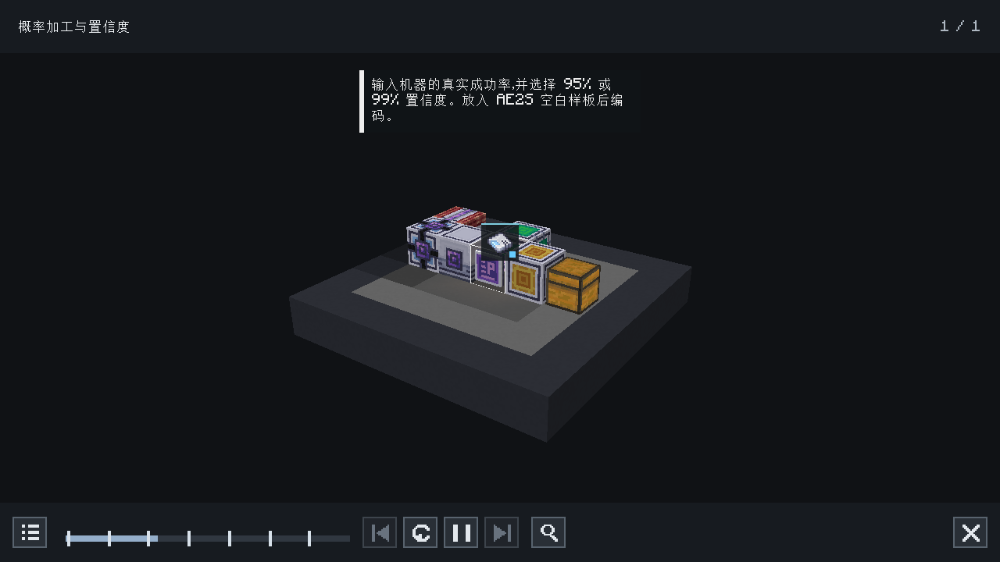

# Cleanroom 0.4.0 正式版成品验收

日期：2026-11-05。成品：`ae2s-probability-pattern-legacy-1.0.1.jar`。

SHA-256：`6ef33ddf52f728cc555afc0029bd0b90cd25d1f3263b74365235b5bffe1b3969`。

使用官方 Cleanroom **0.4.0（无 `-alpha`）** 安装器配方及原版 Minecraft 1.12.2 安装文件，
Java **25.0.5**，AE2S **1.1.0+a47dfe029**。运行 classpath 没有 userdev 或 MCP 开发游戏包。
各场景的 `runtime.json` 固定实际启动命令、库哈希和安装包哈希。

| 场景 | 核心玩法 | 额外覆盖 | 结果 |
| --- | --- | --- | --- |
| [专服，无 Ponder](cleanroom-0.4.0/server-without-ponder/result.json) | 编码、链式规划、CPU 重载、机器派发、产物回网 | 不安装 Ponder / HEI | FUNCTIONAL_PASS |
| [客户端，无 Ponder](cleanroom-0.4.0/client-without-ponder/result.json) | 同上及真实 GUI 数据包 | 无线、万用终端、HEI、中英界面 | FUNCTIONAL_PASS |
| [专服，有 Ponder](cleanroom-0.4.0/server-with-ponder/result.json) | 同第一项 | Ponder 1.4.0 + CraftTweaker 4.1.20.698 | FUNCTIONAL_PASS |
| [客户端，有 Ponder](cleanroom-0.4.0/client-with-ponder/result.json) | 同第二项 | 中英 Ponder 全时间轴、倒放、截图 | FUNCTIONAL_PASS |

最终四组合由 `DISPLAY=:97 python3 tools/verify.py --with-hei` 重现。HEI 验收版本为 `4.35.1`。
编译与发布包检查通过，**16 项单元测试，0 失败、0 跳过**；机器可读汇总见 [summary.json](summary.json)。
发布 jar 未包含测试 harness、Minecraft、AE2S、Ponder 或 HEI 的类。

## 核心功能证据

验收在真实世界中放置原生供电、64k 存储元件、合成 CPU、两个样板供应器、外部箱子机器和自有线缆终端，
通过自然服务端 tick 规划和执行。机器结果采用固定序列，检查用料和产物记账，不以随机成功一次代替功能验收。

- 第一层：每次消耗 2 铁锭，50% 成功率，成功产出 2 金锭，95% 置信度。
- 第二层：每次消耗 3 金锭，80% 成功率，成功产出 1 钻石，99% 置信度。
- 请求 5 钻石时，正确规划 10 次第二层尝试，需要 30 金锭；第一层规划 40 次尝试，需要 **80 铁锭**。
- 将该挂起任务通过原生 CPU 的 NBT 保存并读回后，原生供应器把完整用料送入真实外部库存，产物回网后任务完成，
  最终实际消耗也是 80 铁锭。不同请求量的批次身份和输入量在 decoder / NBT 重载后保持一致。
- 再放入 7 个已有金锭，重复请求同一产物，确认先扣库存，再为剩余的 23 金锭重新计算第一层用料。
- 客户端通过真实窗口和动作数据包改变概率、置信度并编码；无线终端经过充电、绑定、编码，再合并到 AE2S 万用终端，
  设置保持正确。HEI 实际导入处理器提取测试包装器的 42% 成功率，并将输入数量及单一首产物传到服务端。

## Ponder 格式错误修复

中文 `.lang` 文本中的百分号通过 `%%` 转义；Ponder 的英文默认文本直接使用字面量 `%`。
两者经过不同的翻译路径，不能同时把默认英文文本也转义。回归检查遍历全部七段旁白，拒绝
`Format error:`、裸翻译键及泄漏的 `%%`；两种语言均完整播放并倒放，截图在真实客户端帧缓冲中捕获。

[英文截图](cleanroom-0.4.0/client-with-ponder/gameplay/screenshots/ponder-en_us.png) ·
[有线终端](cleanroom-0.4.0/client-with-ponder/gameplay/screenshots/wired-zh_cn.png) ·
[无线终端](cleanroom-0.4.0/client-with-ponder/gameplay/screenshots/wireless-en_us.png) ·
[万用终端](cleanroom-0.4.0/client-with-ponder/gameplay/screenshots/universal-en_us.png) ·
[HEI 导入](cleanroom-0.4.0/client-with-ponder/gameplay/screenshots/hei-transfer-en_us.png)

本结果覆盖上面固定的 AE2S 版本、接口及场景，不延伸为原版 AE2 / AE2UEL 兼容声明。
